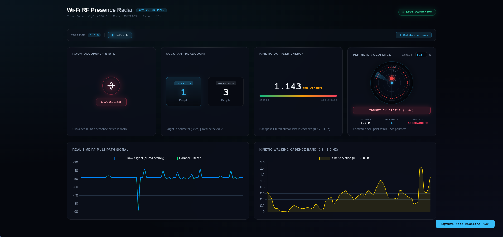

# Wi-Fi RF Presence Radar & Geofence Engine
# Author: Nikita Zhuravlov

A real-time, non-invasive human presence detection, localization, and headcount estimation system powered by ambient 802.11 Wi-Fi signals. By passively capturing physical RF multipath reflections and Doppler phase perturbations, this system tracks room occupancy, counts occupants, and enforces an adjustable perimeter geofence without cameras, wearables, or proprietary radar hardware.

---

<p align="center">
  
</p>

---

## Overview & Architecture

When a human moves within an indoor wireless environment, their body causes microscopic perturbations in the Wi-Fi direct-path and multipath fields. This pipeline processes physical-layer signal shifts using passive monitor-mode packet capture:

- **Downlink Isolation Sniffer:** Filters strictly on the router's hardware transmitter address (TA), eliminating local PC transmission interference.
- **Hampel Filter & Noise Gating:** Discards packet drops, frame corruption, and transient non-human RF artifacts
- **Kinetic Doppler Bandpass (0.3 – 5.0 Hz):** Extracts human motion cadences (walking, limb shifts, and breathing) using a Butterworth bandpass filter
- **Kinetic Velocity Gating & Desk Deadband:** Applies adaptive dual-rate EMA smoothing ($\alpha=0.02$ when seated, $\alpha=0.25$ when walking) and locks the distance estimate at desk proximity ($0.88\text{m}$) while stationary to prevent carrier fading drift
- **Through-Wall Isolation & Geofence Gating:** Filters 2.4 GHz drywall signal bleed (>2.5m) so movement in adjacent rooms does not falsely inflate internal room headcount.
- **Multi-Target Detection & Radar Rendering:** Uses cross-scattering variance and micromotion analysis to identify 2+ occupants simultaneously and visualizes secondary targets on the radar canvas
- **In-Browser 3-Phase Calibration Engine:** Characterizes room multipath parameters (ambient noise floor $\sigma^2_0$, seated torso shadow $P_0$, and path loss exponent $n$) directly in the web UI
- **Dynamic Profile Preset System:** Saves up to 3 custom room calibrations with hot-swapping in memory (zero downtime or server restarts)
- **Integrated Auto-Illumination:** Automatically spawns and cleans up a 50 Hz background packet stream on startup to provide consistent carrier illumination in monitor mode
- **Obsidian Telemetry Dashboard:** Streams 50 Hz real-time waveforms, motion vectors, and a 60 FPS circular radar canvas via WebSockets

---

## Prerequisites

### Operating System & System Tools
- **Linux:** Arch, Debian/Ubuntu, Fedora (`iw`, `iproute2`, `networkmanager` / `nmcli`, `wireless-tools`).
- **Windows:** Windows 10/11 (64-bit) with [Npcap](https://npcap.com/) installed (ensure **"Support raw 802.11 traffic (and monitor mode)"** is checked during setup) OR **WSL2** with USB passthrough via `usbipd-win`.

### Software & Hardware
- **Python:** Python 3.10+ (with `venv` support).
- **Network Hardware:**
  - One primary Wi-Fi/Ethernet interface connected to your local network (for standard internet/routing).
  - One dedicated Wi-Fi card or USB wireless adapter capable of **Monitor Mode** and raw **802.11 Radiotap capture**.

---

## Installation & Setup

### 1. Clone the Repository & Prepare Environment

#### Linux:
```bash
git clone [https://github.com/rektive/Wi-Fi-Presence.git](https://github.com/rektive/Wi-Fi-Presence.git)
cd Wi-Fi-Presence

# Create and activate Python virtual environment
python3 -m venv venv
source venv/bin/activate

# Install project dependencies
pip install --upgrade pip
pip install -r requirements.txt
```

#### Windows (PowerShell as Administrator):
```powershell
git clone [https://github.com/rektive/Wi-Fi-Radar.git](https://github.com/rektive/Wi-Fi-Radar.git)
cd Wi-Fi-Radar

# Create and activate virtual environment
python -m venv venv
.\venv\Scripts\Activate.ps1

# Install project dependencies
python -m pip install --upgrade pip
pip install -r requirements.txt
```

---

### 2. Identify Your Network Interfaces & Router Details

#### Linux:
```bash
# 1. Identify connected interface, SSID, and operating channel/bandwidth
iw dev | grep -E 'Interface|ssid|channel|type'

# 2. Identify the router Gateway IP
ip route | grep default

# 3. Identify the router BSSID (MAC Address)
ip neigh | grep $(ip route | grep default | awk '{print $3}')
```

#### Windows (PowerShell):
```powershell
# 1. Identify connected Wi-Fi interface, SSID, Channel, and Router BSSID
netsh wlan show interfaces

# 2. Identify the default Gateway IP
Get-NetRoute -DestinationPrefix "0.0.0.0/0" | Select-Object -ExpandProperty NextHop

# 3. Identify available packet capture interfaces recognized by Scapy/Npcap
python -c "from scapy.all import show_interfaces; show_interfaces()"
```

Note the following three values from the output:
1. **Target Monitor Interface:** 
   - *Linux:* e.g., `wlan1`, `wlp0s20f0u8`.
   - *Windows:* The exact Scapy device name, network interface name, or Npcap device string (e.g., `Wi-Fi 2` or `\Device\NPF_{GUID}`).
2. **Router Gateway IP:** (e.g., `192.168.1.1` or `192.168.2.1`).
3. **Router BSSID:** (The 6-byte hexadecimal MAC address of your access point, e.g., `00:11:22:33:44:55` or `00-11-22-33-44-55`).

---

### 3. Configure the `.env` File

Create a `.env` file in the project root:

#### Linux:
```bash
cp .env.example .env 2>/dev/null || touch .env
```

#### Windows (PowerShell):
```powershell
if (Test-Path .env.example) { Copy-Item .env.example .env } else { New-Item .env -ItemType File }
```

Open `.env` in your editor and configure the parameters:

```env
# Wi-Fi Interface Configuration
WIFI_INTERFACE=your_monitor_interface_here
ROUTER_IP=your_router_ip
ROUTER_BSSID=00:11:22:33:44:55

# Pipeline Capture Settings
CAPTURE_MODE=monitor
SAMPLING_RATE_HZ=50

# Kinetic Doppler Filter (Human Motion Band: 0.3 - 5.0 Hz)
BANDPASS_LOW_HZ=0.3
BANDPASS_HIGH_HZ=5.0
BUTTERWORTH_ORDER=2

# Thresholds & Feature Extraction
SENSITIVITY_MULTIPLIER=2.5
TRANSITION_COOLDOWN_SEC=1.0

# Web Dashboard Server
HOST=0.0.0.0
PORT=8000
```

---

### 4. Switch the Target Adapter to Monitor Mode

#### Option A: Linux
```bash
# 1. Prevent NetworkManager from interfering with the monitor adapter
sudo nmcli device set <YOUR_MONITOR_INTERFACE> managed no

# 2. Cycle interface into monitor mode
sudo ip link set <YOUR_MONITOR_INTERFACE> down
sudo iw dev <YOUR_MONITOR_INTERFACE> set type monitor
sudo ip link set <YOUR_MONITOR_INTERFACE> up

# 3. Lock to your router's operating channel (e.g., Channel 1 with 40MHz width HT40+)
sudo iw dev <YOUR_MONITOR_INTERFACE> set channel 1 HT40+ 2>/dev/null || sudo iw dev <YOUR_MONITOR_INTERFACE> set channel 1

# Confirm configuration
iw dev <YOUR_MONITOR_INTERFACE> info
```

#### Option B: Windows (Native via Npcap / WLAN Helper)
1. Ensure **Npcap** is installed with raw 802.11 monitor mode support enabled.
2. Open PowerShell as **Administrator** and set the adapter to monitor mode using the Npcap helper utility:
```powershell
# Navigate to Npcap directory
cd "C:\Program Files\Npcap"

# Verify current mode of your target adapter
.\WlanHelper.exe <YOUR_ADAPTER_NAME_OR_GUID> mode

# Switch adapter to monitor mode
.\WlanHelper.exe <YOUR_ADAPTER_NAME_OR_GUID> mode monitor

# Set to the router's operating channel (e.g., Channel 1)
.\WlanHelper.exe <YOUR_ADAPTER_NAME_OR_GUID> channel 1
```

#### Option C: Windows via WSL2 + `usbipd-win` (Recommended for USB Adapters)
If your Windows driver does not support native NDIS monitor mode, attach your USB adapter directly into WSL2:
1. Open PowerShell on Windows as Administrator:
   ```powershell
   # List connected USB devices
   usbipd list

   # Bind and attach the wireless adapter to WSL2 (replace <BUSID> with your device ID)
   usbipd bind --busid <BUSID>
   usbipd attach --wsl --busid <BUSID>
   ```
2. Open your WSL2 Linux terminal and proceed with **Option A (Linux)**.

---

### 5. Physical Room Calibration (2-Point Anchor)

To calibrate the inverse-scatter distance model against your room's physical layout, walls, and furniture profile:

#### Linux:
```bash
sudo $(which python) calibrate_profile.py
```

#### Windows (Run PowerShell as Administrator):
```powershell
python calibrate_profile.py
```

Follow the interactive prompts:
1. **Step 1:** Sit normally at your desk ($\le 1.0\text{m}$ from the antenna) and press **ENTER**. The script samples direct torso shadowing for 6 seconds.
2. **Step 2:** Stand back near the room perimeter ($2.0\text{m} - 2.5\text{m}$) and press **ENTER**. The script samples the unobstructed line-of-sight signal for 6 seconds.

The script generates `profile.json` in your project root, anchoring your near-field and far-field boundaries.

---

## Running the Engine

Start the main detection pipeline with administrative privileges (required for raw packet socket access):

#### Linux:
```bash
source venv/bin/activate
sudo $(which python) main.py
```

#### Windows (PowerShell as Administrator):
```powershell
.\venv\Scripts\Activate.ps1
python main.py
```

Upon launching:
- The background 50 Hz ICMP illumination packet stream starts automatically.
- The downlink-isolated sniffer attaches to your configured monitor interface.
- The FastAPI backend and WebSocket telemetry server initialize on port `8000`.

Open your browser and navigate to:
```text
http://localhost:8000
```

---

## Stopping & Clean System Reset

### Linux
```bash
# Terminate processes and free port 8000
sudo killall -9 python 2>/dev/null
sudo killall -9 ping 2>/dev/null
sudo fuser -k 8000/tcp 2>/dev/null

# Cycle the monitor adapter cleanly back up
sudo ip link set <YOUR_MONITOR_INTERFACE> down
sudo iw dev <YOUR_MONITOR_INTERFACE> set type monitor
sudo ip link set <YOUR_MONITOR_INTERFACE> up
sudo iw dev <YOUR_MONITOR_INTERFACE> set channel 1
```

### Windows (PowerShell as Administrator)
```powershell
# Terminate background Python and ping tasks
Stop-Process -Name "python", "ping" -Force -ErrorAction SilentlyContinue

# Free port 8000 if occupied
Get-NetTCPConnection -LocalPort 8000 -ErrorAction SilentlyContinue | ForEach-Object { 
    Stop-Process -Id $_.OwningProcess -Force -ErrorAction SilentlyContinue 
}

# (Optional) Return adapter back to managed mode via Npcap WlanHelper
cd "C:\Program Files\Npcap"
.\WlanHelper.exe <YOUR_ADAPTER_NAME_OR_GUID> mode managed
```

---

## Dashboard Metrics Reference

| Metric | Description |
| :--- | :--- |
| **Room Occupancy State** | Evaluates overall presence (`VACANT`, `ENTERING`, `OCCUPIED`, `EXITING`) using dual-threshold hysteresis. |
| **In Radius Headcount** | Verified count of occupants actively detected inside the configured perimeter radius. |
| **Total Room Headcount** | Headcount estimated across the entire room and boundary multipath field. |
| **Kinetic Doppler Energy** | Root Mean Square (RMS) of signals passing the $0.3\text{ Hz} - 5.0\text{ Hz}$ bandpass filter. |
| **Perimeter Geofence** | Real-time circular radar sweep tracking target distance, breach state, and radial velocity vector (`APPROACHING`, `RECEDING`, `STATIONARY`). |
| **Real-Time RF Waveform** | Live feed of raw downlink RSSI against Hampel-filtered signal data. |
| **Walking Cadence Band** | Dynamic frequency plot displaying instantaneous kinetic energy variations. |
